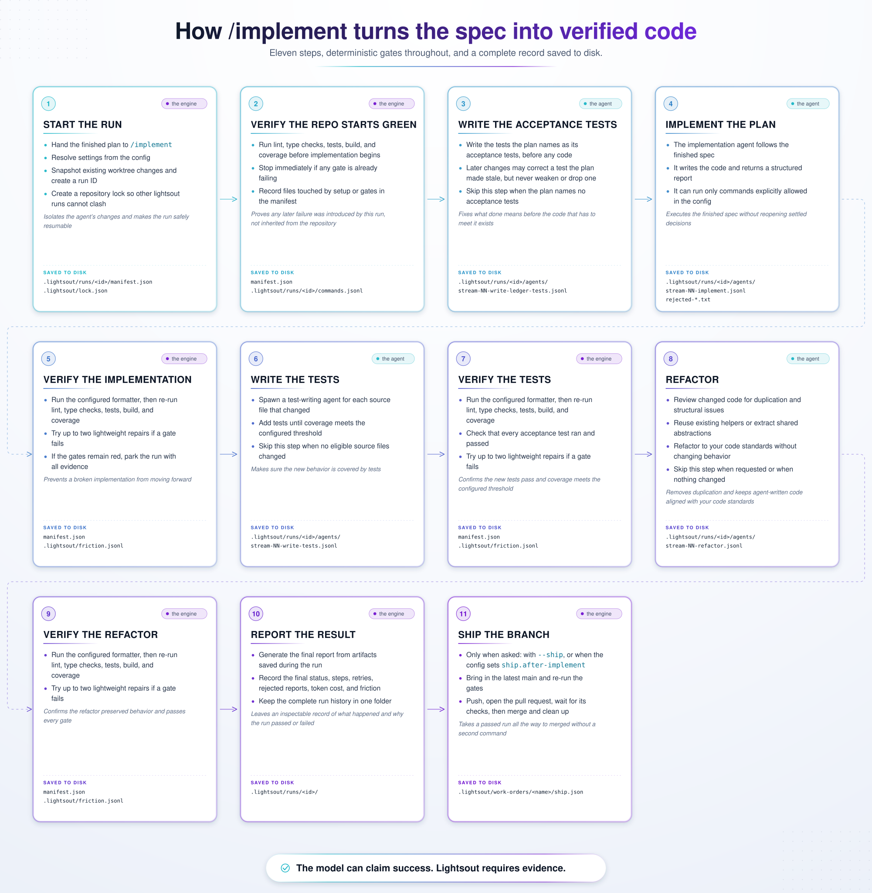

# lightsout

**Stop the slop.** A plugin that helps you and your coding agent write code that meets your standards.

Settle every decision with the agent up front. Hand it off. Walk away. Lightsout runs the plan through a gated pipeline: agents implement, test and refactor, your standards guide how the code is written, and your own commands — tests, lint, types, coverage — decide whether the work passes.

[Website](https://lightsout.dev) · [Commands](https://lightsout.dev/commands) · [Standards Packs](https://lightsout.dev/standards-packs) · [Docs](https://lightsout.dev/docs/configuration)

> **Status: alpha.** Works with Claude Code, Codex, OMP (Oh My Pi) and Pi. MIT licensed.

[](assets/implement-workflow-light.svg)

## Why

Coding agents optimize for the task in front of them, not the shape of the repository. They miss an existing helper and write another, add a second pattern beside the first, and copy whatever shortcuts are nearby. Each change passes; the repo still rots, and the next agent treats the mess as precedent.

- **Humans decide, agents execute.** Scope, architecture, files and acceptance criteria are settled in the plan before any code is written.
- **Your standards at every step.** Your rules are handed to the agents that plan, write, test and refactor — not left for review.
- **Search before writing.** Planning looks for existing code to reuse before anything new is added.
- **Gates, not self-reports.** After each stage lightsout runs your own commands; an agent saying it passed counts for nothing.
- **Cleanup is part of the job.** Every run ends with a refactor pass against your standards.
- **Every run is auditable.** Gate results, agent transcripts, decisions and cost are recorded with the run.

## Quick start

**1. Install the plugin.**

```text
# Claude Code
/plugin marketplace add lightsout-factory/lightsout
/plugin install lightsout@lightsout
```

```sh
# Codex
codex plugin marketplace add lightsout-factory/lightsout
codex plugin add lightsout@lightsout

# OMP (Oh My Pi)
omp plugin marketplace add lightsout-factory/lightsout
omp plugin install lightsout@lightsout
```

**2. Add a `lightsout.config.json`** at the root of your repo, naming the commands that verify the work:

```json
{
  "standards-pack": "lightsout/standards",
  "gates": {
    "check": "pnpm check",
    "test": "pnpm test:unit",
    "test-coverage": "pnpm test:unit:coverage"
  }
}
```

Only `gates` is required. `standards-pack` turns on the built-in standards; leave it out to run with none. See [Configuration](docs/configuration.md) for everything else.

**3. Build something.**

```text
/lightsout:brainstorm add rate limiting to the public API
/lightsout:plan
/lightsout:implement
```

`/brainstorm` turns the idea into a design, `/plan` turns the design into a spec an agent can build without guessing, and `/implement` builds it unattended. Skills are named `/lightsout:<skill>` in Claude Code and OMP, and `/<skill>` in Pi; in Codex, ask for the skill by name ("use the `plan` skill").

## Commands

| Skill | What it does |
|---|---|
| `/lightsout:brainstorm` | Talk a rough idea through until it’s a clear design. |
| `/lightsout:plan` | Turn a feature idea into a plan detailed enough for an agent to build without guessing. |
| `/lightsout:auto-plan` | Run the whole planning process without you, asking only what clears the escalation bar. |
| `/lightsout:implement` | Build a finished plan unattended, with your checks passing at every step. |
| `/lightsout:queue` | Build every ticket marked ready for automation, several at once. |
| `/lightsout:refactor` | Fix the problems the standards check already finds, in small verified batches. |
| `/lightsout:test-coverage-to-threshold` | Write tests until your coverage check passes. |
| `/lightsout:status` | See what lightsout is doing right now. |

The engine also has terminal commands — `doctor`, `ship`, `resume`, `stop`, `report`, `standards-check` and more. See every command, its flags and what it does step by step on the [Commands page](https://lightsout.dev/commands).

## Ticket trackers

Lightsout can work from Linear or Jira tickets: the queue drains them, and each ticket gets one branch and one pull request. Install the add-on for your tracker:

```text
/plugin install lightsout-linear@lightsout
/plugin install lightsout-jira@lightsout
```

Then add the `ticket-tracker` block to your config — see [Ticket tracker settings](docs/configuration.md#ticket-tracker-settings).

## Documentation

- [Configuration](docs/configuration.md) — every `lightsout.config.json` key.
- [Monorepos](docs/monorepos.md) — per-package gates and standards.
- [Commands](https://lightsout.dev/commands) — every command, its flags and its steps.
- [Standards Packs](https://lightsout.dev/standards-packs) — the built-in rules, and how to write your own.

## License

[MIT](LICENSE)
